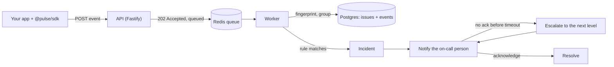

<div align="center">


# Pulse

**Errors in. The right person paged.**

Self-hosted error tracking with on-call paging. Pulse catches every crash in your app, folds the
duplicates into one issue, and wakes whoever is on call. If they don't answer, it wakes the next person.

[](https://github.com/chandandev6/Pulse/actions/workflows/ci.yml)
[](https://github.com/chandandev6/Pulse/actions/workflows/deploy.yml)


[**Live demo → pulse-log.app**](https://pulse-log.app) ·
[Self-hosting guide](docs/self-hosting.md) ·
[SDK guide](packages/sdk-js/README.md) ·
[API reference](docs/api.md)


</div>

---

## Why Pulse?

After an app ships, failures happen quietly. Teams hear about them late (often from users), drown in
duplicate logs, and lose time working out who should respond. Pulse covers the whole path in one
self-hosted tool:

**Detect → Group → Understand → Alert → Acknowledge → Escalate → Resolve**

## Features

### 🐞 Error tracking

- **Drop-in SDK** for Node.js and browsers. It catches uncaught errors automatically and has
  Express and Fastify integrations
- **Smart grouping**: a thousand identical crashes become **one issue** with a count, first/last seen
  and affected users. Line-number changes don't split issues
- **Regressions**: a resolved issue that comes back reopens itself and is flagged
- **Investigation**: full-text search, filters (status, severity, environment, release, dates) kept in
  the URL, stack trace viewer, an event navigator and frequency charts
- **Releases and environments**: see which release introduced an issue, compare two releases, and
  switch between production, staging and others
- **User impact**: "% of users affected" and a high-impact badge

### 🚨 Incident response

- **Alert rules**: new issue, regression, critical severity, more than N events in X minutes, more than
  N users affected. Duplicate incidents are suppressed and rules have a cooldown
- **Notifications**: email, webhooks (HMAC-signed), SMS (Twilio) and browser push, with per-user
  severity preferences and a delivery log
- **On-call schedules**: daily, weekly or custom rotations, layers, time zones (DST-safe) and
  overrides. Exactly one person is on call at any moment
- **One-click acknowledge** from the email. Only the first click wins; everyone else sees who took it
- **Escalation policies**: if nobody acknowledges in time, Pulse moves to the next level, and can
  repeat the whole policy. Every step is in the incident timeline

### 🔒 Ready to self-host

- Per-project **rate limits and monthly quotas**, **PII scrubbing** before anything is stored
  (passwords, tokens, cookies, card numbers), **data retention** and an **audit log**
- Organizations, projects and roles (Owner / Admin / Member), with strict isolation between orgs
- **One compose command** to run everything, with CI and auto-deploy included

## How it works



1. The SDK sends an error to the API, which checks it, scrubs secrets and puts it in a queue.
   It answers right away, so your app never waits.
2. The worker computes a **fingerprint** (the exception type plus your own stack frames, without line
   numbers) and adds the event to the matching issue, or creates a new one.
3. Alert rules are checked. A match opens an **incident**, and the person on call is notified.
4. If nobody acknowledges before the timeout, a delayed job **escalates** to the next level.
   Acknowledging stops it immediately.

## Quick start: run Pulse with Docker

All you need is Docker with Compose v2.

```bash
git clone https://github.com/chandandev6/Pulse.git && cd Pulse
cp .env.prod.example .env.prod   # set APP_SECRET (openssl rand -base64 48) and POSTGRES_PASSWORD
docker compose --env-file .env.prod -f docker-compose.prod.yml up -d --build
```

Open **http://localhost:8080**, sign up, create a project and copy its **DSN**.

HTTPS, hosted databases (Neon), real email, backups and limits are covered in the
**[self-hosting guide](docs/self-hosting.md)**.

## Send your first error

The SDK isn't on npm yet. Build it from this repo and install it from the folder:

```bash
pnpm --filter @pulse/sdk build
cd /path/to/your-app && pnpm add /path/to/Pulse/packages/sdk-js
```

```js
import Pulse from "@pulse/sdk";

Pulse.init({
  dsn: "http://<public_key>@localhost:8080/<project_id>", // from the project page
  environment: "production",
  release: "1.4.2",
});

// Uncaught errors are now reported automatically. You can also report by hand:
try {
  riskyThing();
} catch (err) {
  Pulse.captureException(err, { tags: { feature: "checkout" } });
}
```

Express and Fastify setup, `setUser`, `beforeSend`, sampling and the event format are in the
**[SDK guide](packages/sdk-js/README.md)**.

Not using JavaScript? Any language can send JSON to the API:

```bash
curl -X POST http://localhost:8080/api/<project_id>/events \
  -H "X-Pulse-Key: <public_key>" \
  -H "Content-Type: application/json" \
  -d '{"message":"Something broke","level":"error","environment":"production"}'
```

## Tech stack

| Layer          | Tools                                                              |
| -------------- | ------------------------------------------------------------------ |
| API + worker   | Node.js 22, TypeScript, Fastify, Zod, BullMQ                       |
| Database       | PostgreSQL with Drizzle ORM (full-text search, trigram indexes)    |
| Queues & cache | Redis (ioredis): queues, delayed jobs, rate limits, alert windows  |
| Dashboard      | React, Vite, React Router, TanStack Query                          |
| SDK            | `@pulse/sdk` for Node.js and browsers (ESM + CJS, built with tsup) |
| Notifications  | nodemailer (SMTP), signed webhooks, Twilio, Web Push               |
| Testing        | Vitest, Testing Library, Playwright                                |
| Tooling        | pnpm workspaces, Biome, GitHub Actions                             |
| Production     | Multi-stage Dockerfile, nginx, Docker Compose                      |

The live site at [pulse-log.app](https://pulse-log.app) runs on an Azure VM behind a Cloudflare
Tunnel, with Neon Postgres and Redis on the VM. Every green push to `main` deploys itself.

## Project structure

```
apps/
  api/          API server + worker (Fastify, BullMQ, Drizzle)
  web/          Dashboard + landing page (React + Vite)
packages/
  sdk-js/       JavaScript SDK (@pulse/sdk)
  shared/       Code shared by the API and the SDK (event schema)
examples/
  node-app/     A small app that breaks on purpose
deploy/         nginx config for production
docs/           Self-hosting guide, API reference
scripts/        Load test
.github/        CI and deploy workflows
```

## Development

### Requirements

- Node.js 22+
- pnpm 10+
- Docker

### Setup

```bash
pnpm install
cp .env.example .env
docker compose up -d                      # Postgres, Redis and Mailpit
pnpm --filter @pulse/api db:migrate
```

### Run

```bash
pnpm dev       # API (:3000) + dashboard (:5173)
pnpm worker    # in a second terminal: processes events, alerts and notifications
```

- Health check: http://localhost:3000/health
- Dashboard: http://localhost:5173
- Mailpit inbox (local email): http://localhost:8025

To see real issues appear, create a project, put its DSN in `PULSE_DSN` and run `pnpm example`.

### Scripts

| Command          | What it does                                    |
| ---------------- | ----------------------------------------------- |
| `pnpm dev`       | Start the API and dashboard in watch mode       |
| `pnpm worker`    | Start the background worker                     |
| `pnpm example`   | Run the example app (needs `PULSE_DSN`)         |
| `pnpm test`      | Run all unit and integration tests              |
| `pnpm e2e`       | Run the browser tests (Playwright)              |
| `pnpm typecheck` | Check TypeScript types                          |
| `pnpm lint`      | Check code with Biome                           |
| `pnpm format`    | Fix formatting with Biome                       |
| `pnpm load-test` | Load test event ingestion (needs `PULSE_DSN`)   |

### Testing and CI

There are about 280 tests across the API, dashboard and SDK, plus end-to-end browser tests that
cover signing up, acknowledging an incident from a real email, and a full escalation.

[CI](.github/workflows/ci.yml) runs lint, typecheck, migrations, tests and builds on every push and
pull request, and checks that the production Docker images still build. After CI passes on `main`,
the [deploy workflow](.github/workflows/deploy.yml) updates the live server.

Load test result: the API accepts about **1,900 events/s** with a p99 of about 60 ms.

## Documentation

- [Self-hosting guide](docs/self-hosting.md): containers, configuration, HTTPS, hosted databases, backups
- [SDK guide](packages/sdk-js/README.md): setup, frameworks, scope, event format
- [API reference](docs/api.md): every endpoint, who can call it and what it returns
- [PRD.md](PRD.md): the product plan, how every feature was built, and current progress

## Roadmap

Every planned feature (F0–F15) is done. Next up:

- [ ] Publish `@pulse/sdk` to npm
- [ ] Privacy page
- [ ] Code-splitting the dashboard for faster loads
- [ ] Source maps for minified browser stack traces
- [ ] SDKs for more languages
- [ ] Performance monitoring

See [PRD.md](PRD.md) for the full plan.
